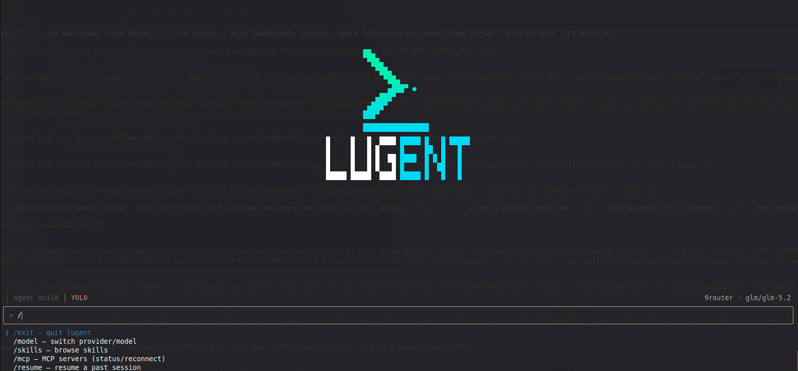

<p align="center"></p>

# lugent

A minimal OpenCode-style coding agent. REPL CLI over a pure core library — TypeScript + Bun, zero runtime dependencies.

**[lugent(1) — landing page](https://luizrgf2.github.io/lugent/)** · **[docs](https://luizrgf2.github.io/lugent/getting-started/)** — one page per topic (agents, subagents, skills, MCP, permissions, sessions)

## Install

```bash
npm i -g lugent        # requires Bun installed (bun >= 1.4)
# or straight from bunx
bunx lugent
```

Runs the TUI on a TTY, plain REPL otherwise (`--plain` forces it).

<p align="center"></p>

## Run from source

```
bun src/main.ts
```

## Requirements

- [Bun](https://bun.sh) 1.3+
- Any OpenAI-compatible chat endpoint (`/v1`): Ollama, LM Studio, OpenRouter, local routers, etc.

## Configuration

For `providers`, `defaultProvider`, `defaultModel` and `defaultAgent` lugent reads the **first file found** — no merging between the two:

1. `<project>/lugent.json` (wins)
2. `~/.config/lugent/config.json` (global fallback; works on Windows too)

(`mcp`, agents and skills merge both files instead — see below.)

```json
{
  "providers": {
    "ollama": {
      "baseUrl": "http://localhost:11434/v1",
      "apiKey": "{env:OLLAMA_API_KEY}"
    }
  },
  "defaultProvider": "ollama",
  "defaultModel": "qwen3.5:14b",
  "mcp": {
    "chrome-devtools": { "type": "local", "command": ["npx", "-y", "chrome-devtools-mcp@latest"] },
    "takeflow": {
      "type": "remote",
      "url": "https://chatback.takeflow.com.br/mcp",
      "headers": { "X-Tenant": "{env:TAKEFLOW_TENANT}" }
    }
  }
}
```

| Field | Description |
| --- | --- |
| `providers.<name>.baseUrl` | OpenAI-compatible base URL. Must include `/v1` |
| `providers.<name>.apiKey` | Optional. `{env:VAR}` is substituted at load; unknown vars become `""` |
| `providers.<name>.models` | Optional cached list of model ids. Written by `/add-provider` from the endpoint's `/models`; when present, `/model` lists it instead of calling the endpoint |
| `defaultProvider` | Key into `providers` used at startup |
| `defaultModel` | Model id sent as `model` on every request |
| `defaultAgent` | Optional agent id selected at startup. Defaults to `build`; unknown id → warning, then `build` |
| `defaultSubagentModel` | Optional `provider/model` a subagent **without** its own `model` runs on. Hierarchy: the subagent's `model` → `defaultSubagentModel` → the chat's current model. A bad format warns and is ignored | none — subagents inherit the chat's model |
| `permissionMode` | Optional, `normal` (default) or `yolo`. Startup permission mode — TUI only. Saved to the global config by `/permissions`; a project value overrides it while present |
| `mcp.<name>.type` | `local` (spawns `command`) or `remote` (`url`); `http` is an alias for `remote`. Inferred when absent |
| `mcp.<name>.command` | `local`: argv array, e.g. `["npx","-y","pkg@latest"]` |
| `mcp.<name>.environment` / `.cwd` | `local`: extra env (values support `{env:VAR}`) and working dir relative to the project |
| `mcp.<name>.url` | `remote`: Streamable HTTP endpoint |
| `mcp.<name>.headers` | `remote`: extra headers (values support `{env:VAR}`) |
| `mcp.<name>.scopes` | `remote`: optional string array requested during OAuth sign-in. Without it, no `scope` parameter is sent and the authorization server's consent screen decides |
| `mcp.<name>.enabled` | `false` skips the server at startup (the entry stays, listed `disabled` by `/mcp`, so it can be re-enabled for the session) |
| `mcp.<name>.timeout` | Per-request timeout in ms (default `30000`) |

Unlike `providers` (first file found wins), `mcp` **merges** both config files — global first, project wins per server — the same way agents and skills merge. A project entry replaces the whole global entry; to disable a server declared in the other file, repeat it with `enabled: false` — either the whole entry, or just `{ "enabled": false }` as a marker. Markers are applied last and win wherever the server was declared, so your global config can switch off a server a repo declares.

At startup each provider gets a health check (`GET /models`, 8s timeout) — unreachable ones are reported as `OFF` but lugent still starts.

You do not have to hand-edit the file to add a provider: `/add-provider` (both UIs) writes it for you. The form writes the **global** file only, never the project one, and keeps every other key — `permissionMode`, `mcp`, `defaultProvider` and other providers all survive. The key is stored exactly as typed (`{env:VAR}` included) and is never printed back in either UI: the TUI renders a fixed run of dots, and the `--plain` REPL reads that one prompt with its own masked reader (`•` per character, readline's echo muted for the duration) rather than `readline`'s ordinary echo — so the key never lands in terminal scrollback. A file that ends up holding an inline key is set to mode `0600`. `baseUrl` trailing slashes are stripped on save, and a `{env:VAR}` key is resolved for the live session (the file keeps the reference) so the new provider works on the next turn without a restart. A failed **Test** is recoverable — backspace returns to the key field with everything you typed intact, and `⌫` on an empty field or `←` walks further back to the base url and the name, so a wrong port or `/v1` costs one edit rather than a retyped form. If the endpoint answers but advertises no models — an empty `{"data":[]}` **or** a body that is not JSON at all, which is what a login page or a proxy error page returns — the form offers to save the provider without a `models` list; for a provider that already has one, the cached list is **kept** (the confirmation and the result line say so — nothing is reported as imported that was not). A name that already exists is never replaced silently: both UIs ask first, and the question says what is replaced (base url, model list) and what is kept (the stored key, when the key field is left empty). Because a blank key field keeps the stored key, the **Test** sends that key too — read from the global file for that name, `{env:VAR}` resolved, so re-running the command (the only refresh path) works against an endpoint that enforces auth instead of 401ing on a key the user never had to retype. The overwrite check reads the global file itself, not just the loaded config — a project `lugent.json` shadows the global providers from `loadConfig`, so the live map alone would miss exactly the entries the save would overwrite.

## Usage

In a terminal, `lugent` starts a **full-screen TUI** (React + Ink): the big L-mark logo (chevron + base + agent dot, half-block raster of the SVG logo, SVG-exact gradient) with a block-letter `LUGENT` wordmark (white/cyan, five rows of 5×5 glyphs) beneath opens **horizontally and vertically centered** on the empty screen; the moment the first item lands, the logo is committed once to the conversation's top (terminal scrollback) and never re-rendered — it stays at the start of the conversation, not between messages; scrollable transcript (items separated by blank lines, answers indented) with live model reasoning (labeled `… pensando` block, indented), markdown-rendered answers (headings, tables, lists), tool lines, inline y/n/a permission dialogs, and one chrome line above the composer (a blank row keeps the transcript off it): `§ AGENTS.md loaded │ agent <id> │ YOLO` on the left, spinner + `working…` (while a turn runs) and the always-visible `provider · model` on the right.

```
                                          ██▄
                                           ▀██▄
                                             ▀██▄
                                               ▀██▄
                                                ▄███▀ ●
                                             ▄███▀
                                           ▄███▀
                                          ███▀
                                          ▄▄▄▄▄▄▄▄▄▄▄▄▄▄▄▄
                                          ▀▀▀▀▀▀▀▀▀▀▀▀▀▀▀▀
                                               LUGENT

> go                                ▏   composer: Enter submits, ↑/↓ history
  pondering which tool to use…         reasoning (dim, live)
▸ read src/main.ts                     tool calls
  all **done**                         answer (markdown-lite)
```

(The logo above is shown as it opens on a 30-row terminal — 9 blank rows sit above it, none below in this excerpt.)

- **Ctrl+C once** aborts the running turn (and denies a pending permission); **twice** exits.
- **Runaway guards** (nothing runs forever): a model stream ends after 10min even if the proxy keeps sending keep-alive bytes, and an MCP server that never stops paginating its tools fails to connect instead of hanging startup. Tool rounds are uncapped — the model decides when a turn is done, ctrl+c aborts. Provider failures (`429`/`5xx`, stalled streams, hosts that never answer — 15s connect cap) retry **indefinitely** with backoff (starts at 10s, doubles, 60s cap) — every failed attempt shows in the UI (`attempt 3 failed — HTTP 503 · retrying in 40s`), and ESC stops the loop. Client errors (401, 400 — bad key, bad request) fail immediately instead of looping. When the loop is stopped it surfaces (`HTTP 503 (after N attempts)`), including mid-stream error events and 200-with-JSON-error responses.
- **Scrolling works like any terminal program**: finished turns are printed into the terminal's own scrollback, so the **mouse wheel, touchpad and click-drag selection** scroll the whole conversation natively — no capture, no commands, copying always works. The live frame below holds only the turn in progress: **PageUp/PageDown** (or **Shift+↑/↓**) page through it, **Home/End** jump to its top/tail, and scrolling up while the answer streams **pins the view** — new content grows below without jumping the screen. Submitting a new message snaps back to the tail. The frame is a fixed-height column: the composer and the chrome line stay put, and a long answer that wraps (or a picker opening) can never push the input off-screen.
- Slash commands: `/exit` quits; `/model` opens a two-level picker (provider → model list — the cached `models` when the provider has one, otherwise a live `listModels()`, `↑/↓`+Enter, Esc cancels, Ctrl+C closes) — the choice is pinned to the session, so `/resume` brings it back; `/skills` browses loaded skills; `/mcp` lists the MCP servers with their status and lets you reconnect, disable or enable one, sign in with OAuth (`authenticate`) or sign out (`logout`); `/resume` picks a past session of this directory (replays its transcript with its last provider/model, next turn continues it — not a fork); `/permissions` toggles normal/yolo (yolo auto-approves every tool call; a red `YOLO` badge shows on the chrome line above the composer); `/agent` opens the agent picker — the chosen profile's prompt, model and toolset apply from the next turn, and the chrome line shows the active agent (`build` by default). `/add-provider` opens a form (name, base URL, API key) where **Test** calls `<baseUrl>/models` — only a `200` with at least one model unlocks **import**, which writes the provider and every model id to the global config and makes it selectable in `/model` immediately; a failed Test can be retried after a backspace back to the fields (values intact, and `⌫`/`←` walk all the way back through the url to the name), and a `200` with no models offers a models-less save instead — which keeps an existing cached list rather than dropping it. Typing `/` in the composer shows an autocomplete box — it filters as you type, `↑/↓` move, Enter or Tab completes. Others work in `--plain` mode.
- **Pasting multi-line text** collapses into an inline token — `[paste #1: 100 lines]` (or `X chars` for a long single line, threshold 200 chars) — instead of flooding the composer. Tokens are atomic: the caret can't enter one, ←/→ step over the whole token, and backspace deletes it as a unit. `↑/↓` history recall preserves tokens; on Enter the full pasted text is expanded back into what the model receives (so the transcript and the stored message show the expanded paste, while the composer and history stay compact).
- `--plain` forces the inline REPL below; piped stdin (non-TTY) falls back to it automatically. When the TUI starts it erases the visible viewport (scrollback is kept): shell leftovers and startup warnings stay reachable above, not interleaved with the UI. In `--plain`, `/add-provider`'s api key prompt is masked (`•` per character) rather than echoed as you type.
- **Image attachments**: mention a file with `@path/to.png` in your message (`.png` `.jpg` `.jpeg` `.gif` `.webp`, ≤20 MB, relative to the project root). It is sent to the model as an OpenAI vision `image_url` part — works with any multimodal model behind an OpenAI-compatible endpoint. Unresolvable markers stay literal text.

Plain REPL:

```
  ▟▙                              ANSI L-mark logo (terminal colors,
 ▟▛ ▚▖                             gradient from docs/lugent.svg)
▟▛   ▚▖
▀▀▀▀▙
LUGENT
┌─ lugent ──────────────┐
│ session ses_676f…     │      banner on startup
│ 9router · glm/glm-5.2 │
└───────────────────────┘
> read src/main.ts            # plain message: the model drives the tools
▸ read  src/main.ts           # tool lines use glyphs (▸ read, ✎ edit, $ shell…)
⠙ thinking…                   # spinner while the turn runs
> /model                      # list models of the current provider
> /model ollama qwen3.5:14b   # switch provider (+ optional model)
> /skills                     # list advertised skills
> /mcp                        # list MCP servers and their status
> /mcp disable echo           # take a server (and its tools) out of the session
> /mcp auth takeflow          # open the browser and sign in to a remote server (OAuth)
> /add-provider               # form: name, base url, api key → test → import its models
                              # (an existing name asks [y/N] before it is replaced)
> /clear                      # start a fresh session
> /resume                     # list this directory's sessions, pick one to continue
> /exit                       # quit
```

- UI is hand-rolled ANSI (`src/cli/ui.ts`) in plain mode; colors/spinner auto-disable when output is piped.
- Permission prompts answer `y` / `n` / `a` (always, session-scoped). Anything else — including Enter — denies.
- `--db <path>` overrides the database location.

## Tools

| Tool | Default | Does |
| --- | --- | --- |
| `read` | allow | File with numbered lines (offset/limit) or directory listing; rejects binary |
| `glob` | allow | Glob file search (`**/*.ts`), limit 100 |
| `grep` | allow | Content search, `path:line:preview`, regex or literal, skips binary |
| `edit` | ask | Unique-match string replace (`replaceAll` opt-in), returns diff |
| `write` | ask | Create/replace file, creates parent dirs |
| `shell` | ask | `bash -c` (`cmd /c` on Windows), timeout default 2min, `background: true` |
| `skill` | allow | Load a skill body by id |
| `subagent` | ask | Launch a subagent in a child session (id from the `# Subagents` list, fresh context); returns the child's final message. While it runs, the TUI tool line shows the child's live status (`agent · activity · elapsed`) |

**Extra guard:** any resource outside the project root (absolute path, `..`, `~`) forces an `ask` even for `allow` tools, unless already granted for the session.

MCP tools are added on top, named `<server>_<tool>` (non-`[A-Za-z0-9_-]` characters become `_`, runs of `_` collapse to one, capped at 64 chars); a name collision drops the later tool, not the server. They always default to `ask` — see [MCP](#mcp) below.

## MCP

lugent speaks the Model Context Protocol over two transports, declared in the `mcp` map (see [Configuration](#configuration)):

- **`local`** — spawns a child process and talks newline-delimited JSON-RPC over its stdio (e.g. `chrome-devtools`, `browsermcp`).
- **`remote`** (alias `http`) — Streamable HTTP: one POST per JSON-RPC message, with `Mcp-Session-Id` handling, SSE responses and `202` notifications.

At startup every enabled server is connected in parallel, its tools are listed and bridged into the tool registry as `<server>_<tool>`. A server that fails to start is reported as `mcp: <name>: <reason>` and **never stops lugent** — the rest keep working. A `remote` server that answers `401` is reported as needing authentication instead of failing (see below). A `local` server whose child dies later flips to `failed` on its own, so `/mcp` can bring it back (a `remote` server is only noticed on its next failed call). MCP servers are untrusted third parties, so their tools are permission-gated (`ask` by default) and an agent's `tools`/`permissions` can allow, ask or deny them by name.

**Trust note:** a project `lugent.json` can declare `local` servers, whose `command` is spawned at startup with no prompt — same trust channel as a project `AGENTS.md`, skills or agents (see `docs/decisions.md`, 2026-10-24). Read a repo's `mcp` block before running lugent in it; every server is listed by `/mcp` and any failure is printed at startup.

`/mcp` lists every server with its status — `connected` (with a tool count), `connecting` (a handshake still in flight), `failed` (with the error), `auth_required` (needs a sign-in) or `disabled` — and lets you act on one:

- `connected` (remote) → **logout** or **disable**; `connected` (local) → **disable**
- `disabled` → **enable** (reconnects)
- `auth_required` → **authenticate** or **disable**
- `failed` → **reconnect** or **disable**

In `--plain` mode the same actions are explicit: `/mcp`, `/mcp reconnect <name>`, `/mcp disable <name>`, `/mcp enable <name>`, `/mcp auth <name>` (also `/mcp authenticate <name>`) and `/mcp logout <name>`.

Enabling and disabling is **session-scoped** — lugent never rewrites `lugent.json` (a turn must not silently edit a file that can hold secrets). Restart to fall back to the configured state; persistence is deferred (see `docs/future-features.md`).

### Signing in to a remote server (OAuth)

A `remote` server that refuses the configured headers (or has none) answers `401` with a discovery hint. lugent does **not** fail it — it reports the server as **`auth_required`** at startup and in `/mcp`, because the fix is interactive:

```
mcp: takeflow: needs authentication — run /mcp and choose authenticate
```

Choose `authenticate` (`/mcp auth takeflow` in `--plain` mode) and lugent:

1. probes the endpoint, reads its protected-resource metadata and the authorization server's metadata (RFC 9728 / RFC 8414, **https only**);
2. registers itself as a public client via dynamic client registration (RFC 7591) — once per server, then reuses the stored `client_id`;
3. starts a loopback listener on `http://127.0.0.1:48762/oauth/callback`, builds the consent URL with PKCE S256, prints it as a fallback and opens your browser;
4. waits up to **5 minutes** for the redirect (ctrl+c cancels), then exchanges the code — always sending the `resource` parameter, so the token is bound to that MCP endpoint — and verifies the `iss` when the server advertises it;
5. stores the tokens in `~/.local/share/lugent/mcp-oauth.json` (mode `0600`) and reconnects the server.

The token is bound to the URL that issued it: a project `lugent.json` shadowing a global server name never hands over the global credential. Access tokens are refreshed proactively (60 s before expiry) and once more, forcibly, when the server answers `401` mid-session; if the refresh token itself is rejected the tokens are dropped and the server returns to `auth_required`. `logout` revokes at the authorization server when it offers a revocation endpoint, then deletes the local copy.

The port is fixed on purpose — it must match the registered redirect URI — and a busy port fails loudly instead of hanging. Scopes are optional (`mcp.<name>.scopes`); without it, no `scope` parameter is sent at all.

**The agent knows this surface.** lugent's system prompt carries a short `# MCP` section — always present, and *outside* the agent prompt, so it stays when you switch to `plan` or a custom agent. You can therefore ask how MCP works here or where the config lives, and ask it to install a server: it edits `lugent.json` with the normal `write`/`edit` tools (both `ask`, so nothing is rewritten without your approval) and tells you to restart. Put tokens in `{env:VAR}`, never inline — especially in a project file that may be committed.

**Index:** [`docs/architecture/mcp.md`](docs/architecture/mcp.md) (transports, client, tool bridge) · [`docs/architecture/mcp-oauth.md`](docs/architecture/mcp-oauth.md) (sign-in, token store, refresh) · [`docs/decisions/mcp.md`](docs/decisions/mcp.md) (why each choice) · [`docs/future-features.md`](docs/future-features.md) (what is deferred).

## Skills

Drop markdown files in `.agents/skills/` — nested dir or flat. Both scopes load (user `~/.agents/skills/` + project `.agents/skills/`; on Windows the user scope is `%USERPROFILE%\.agents\skills` — same layout). Same id → project wins:

```
.agents/skills/git-release/SKILL.md   → id "git-release"
.agents/skills/review.md              → id "review"
```

```markdown
---
name: Git Release
description: Prepare and publish releases
---
Step 1: ...
```

Skills with a `description` in the frontmatter are advertised in the system prompt (id, name, description only). The model loads the full body on demand via the `skill` tool — skill content never bloats the prompt upfront.

Using skills in a session:

- **Let the model pick them.** Advertised skills appear in the system prompt; when your request matches a description ("prepare a release"), the model calls `skill git-release` itself — you see the `▸ skill` line in the transcript.
- **Force one:** mention the id in your message ("use skill git-release to …").
- **Browse:** TUI `/skills` lists what is loaded (read-only, ↑/↓+Esc); plain REPL `/skills` lists ids. Toggling skills on/off is not implemented — every loaded skill is active in every session (selector design deferred, see `docs/future-features.md`).

**Index:** [`docs/architecture/prompt-and-agents.md`](docs/architecture/prompt-and-agents.md) (how skills reach the prefix) · [`docs/future-features.md`](docs/future-features.md) § Skills (selector, deferred).

## Agents

An agent is a named profile — system prompt, model, tool allowlist, permission overrides — defined in markdown, same shape as skills:

```
.agents/agents/reviewer.md         → id "reviewer"
.agents/agents/team/audit.md       → id "team/audit" (nested path is the id)
~/.agents/agents/reviewer.md       → user scope; project wins on the same id
```

### Built-in agents

Three agents are always present, in every install (`build`/`plan` from OpenCode's pair, adapted: no rule engine, no plan files; `general` its default subagent):

| Id | Mode | Prompt | Tools | Permissions |
| --- | --- | --- | --- | --- |
| `build` | primary | the base system prompt | all | tool defaults |
| `plan` | primary | "plan mode": explore and design, no file changes | all but `edit`/`write` | `{edit: deny, write: deny}` |
| `general` | subagent | general-purpose task runner, fresh context | all (spawn drops `subagent` itself) | tool defaults |

Built-ins carry display colors (`build` magenta, `plan` yellow, `general` cyan); the TUI context line — fixed above the input — shows a yellow `§ AGENTS.md loaded` when a project `AGENTS.md` was loaded, plus `· agent <id>` in the agent's color.

`build` is the startup default, so there is always a way back to a normal session (`/agent build`). `plan` can read, search and run shell commands — shell stays permission-controlled, as in OpenCode — it just cannot modify files. Both load **first**, so a file with the same id (user or project) overrides the built-in without removing it: drop `.agents/agents/plan.md` to give your own plan agent.

```markdown
---
description: Reviews changes read-only
color: cyan
model: 9router/glm-5.2
tools: [read, glob, grep]
permissions: {shell: ask}
---
You are a code reviewer. Report findings with file and line references.
```

| Field | Meaning | Default when absent |
| --- | --- | --- |
| `name` | the agent's **id** (what `/agent` and the `subagent` tool address). The file's relative path (`team/x.md` → `team/x`) is only the fallback, so a nested `reviewer/agent.md` with `name: reviewer-2` loads as `reviewer-2`. Precedence compares the final id, so a project file wins a user file that picks the same `name` | the path |
| `description` | shown by `/agent` and the `# Subagents` catalog; surrounding quotes are stripped | none |
| `color` | TUI display color for the agent: an ink color name (`red`, `cyan`…) or `#rrggbb`; display-only, invalid warns and uses the default | `magenta` (build's) |
| `model` | `provider/model`, both required — provider must exist in the config. **Explicit or fatal**: a declared model whose provider is not configured stops lugent at activation (`/agent`, startup, `/resume`) or before the child session is created (spawn) — it never silently inherits | inherit the session's |
| `tools` | tool ids sent to the model; anything else is invisible to it — a `tools` key that parses to nothing (typo, block-style YAML) fails closed to **no** tools, with a warning | all tools |
| `permissions` | per-tool `allow` / `ask` / `deny`; `deny` also removes the tool | tool default |
| `mode` | `primary` \| `subagent` \| `all` — who may launch this agent (`agent` is accepted as a spelling of `primary`); invalid warns and uses the default | primary |

Legacy frontmatter from Claude Code-style files is translated, never dropped: `subagent: true` loads as `mode: subagent` (deprecation warning; an explicit `mode` wins), and `commandExecutionPolicy: off` loads as `permissions: {shell: deny}` — unless the same file declares `permissions.shell` explicitly, which wins.

### Subagents

A `mode: subagent` (or `all`) agent is not a session you switch into — it is a worker the model launches. During a turn the model can call the `subagent` tool with `{ agent, prompt }`; lugent starts a **child session** (a second session in the same store, same process) that runs with the subagent's own prompt, model and tools, and the child's final message comes back as the tool result.

- The model discovers subagents from a `# Subagents` section of the prompt (id + description), rendered only when at least one is launchable — same mechanism as `# Skills`.
- The child starts with **no** shared history: the prompt must be self-contained.
- **Model hierarchy** (explicit, no silent fallbacks): the subagent's declared `model` → `defaultSubagentModel` from the config → the chat's current model. A declared model whose provider is not configured is **fatal** — the spawn stops before any child session exists and lugent exits with the error, instead of running the child on the wrong model.
- Several `subagent` calls in one tool round run in parallel.
- **Live view (TUI)**: while a child runs, its `subagent` tool line shows `agent · activity · elapsed` in real time (`ctrl+c` behavior unchanged). **`ctrl+1`..`ctrl+9`** open child N of the current turn — a read-only live transcript of that child (tokens, reasoning, tool lines, same windowing as the frame); `esc` or Ctrl+C closes. Past 8 children `ctrl+9` opens a windowed picker instead of a direct map. Children keep working after the turn commits and after `/resume` (rehydrated from the store; reasoning was never persisted). The keys need a terminal with the [kitty keyboard protocol](https://sw.kovidgoyal.net/kitty/keyboard-protocol/) (lugent enables its disambiguate flag and pops it on exit) — without it, ctrl+digit is indistinguishable from a plain digit and the viewer stays unreachable. `--plain` prints a dim `↳ subagent … started/finished` line pair instead.
- **Depth 1**: a child never gets the `subagent` tool or the catalog, so it cannot launch a grandchild.
- Children are persisted (with a `parent` link) but **hidden** from `/resume` and the TUI picker; only the child's final message returns to the parent.
- `mode: subagent` agents are not offered in `/agent` — they are launch targets, not session personas.
- The `general` built-in ships as a subagent, so delegation works with zero files; shadow or repurpose it with `.agents/agents/general.md` like any built-in.

```markdown
---
description: Probes one file and summarizes it
mode: subagent
tools: [read]
---
You are a probe. Read exactly one file and summarize it in three lines.
```

Usage: `/agent` lists loaded agents (`build` and `plan` plus your file agents), `/agent reviewer` switches.

The body is the agent's system prompt: it **replaces** the base prompt, and AGENTS.md plus the skills advertisement are still added on top. A permission override replaces the tool's default — a session `always` grant still wins over it, and the outside-project guard still forces an ask.

Usage: `/agent` lists loaded agents (`build` and `plan` plus your file agents), `/agent reviewer` switches. Switching works mid-session — history is kept and the next turn runs with the new prompt, model and toolset; the switch line confirms provider/model/toolset, and the `# Tools` section of the prompt is filtered to match. An agent's `model` applies at startup (`defaultAgent`) and on `/resume`, not only when switched to — and a declared model whose provider is missing **kills the process** at that moment (`/agent`, startup, `/resume`) instead of falling back; the TUI picker and resume print the error and refuse the switch. `/resume` restores the agent together with provider and model; `defaultAgent` picks the startup agent and defaults to `build` — an unknown id warns and falls back to `build`. Because `build` reuses the base prompt, the default system prefix stays byte-identical to a session with no agent (and sessions created before agents existed keep the base prompt). Bad frontmatter never breaks startup: an empty body drops that agent, and an unknown tool id or a `model` without `provider/` warns and falls back.

**Index:** [`docs/architecture/prompt-and-agents.md`](docs/architecture/prompt-and-agents.md) (the `# Subagents` catalog) · [`docs/architecture/turn-flow.md`](docs/architecture/turn-flow.md) (the child branch in the loop) · [`docs/decisions/agents.md`](docs/decisions/agents.md) (why one tool, why depth 1) · [`docs/future-features.md`](docs/future-features.md) § Agents (background subagents, deferred).

## Permissions & yolo

Every tool has a default (`allow` / `ask`, table above). During a turn the model may trigger an inline dialog:

- Answer `y` (once), `n` (deny — the model sees the refusal), or `a` (always this session, for that tool+resource). Anything else — including Enter — denies.
- Any resource outside the project root (absolute path, `..`, `~`) forces `ask` even for `allow` tools.

**Yolo mode** (TUI only — `--plain` REPL has no equivalent): `/permissions` → pick `yolo` and every tool call is auto-approved — no dialogs, **including outside-project paths**. The status bar shows a red `YOLO` while active. The choice is **persisted to the global config** (`permissionMode` in `~/.config/lugent/config.json`) and applied at startup; a `permissionMode` in the project's `lugent.json` overrides it while present (first-file-wins, like `providers`). Yolo does not modify the per-session `a` grants. `/permissions` → `normal` (or edit the config) turns it off.

## Data

Sessions, messages and permission grants live in one SQLite file:

- Linux: `$XDG_DATA_HOME/lugent/db.sqlite` or `~/.local/share/lugent/db.sqlite`
- Windows: `%APPDATA%\lugent\db.sqlite`

## Development

```
bun test
```

The suite includes a golden snapshot pinning the system prompt byte-for-byte (provider prefix-cache stability) and an end-to-end turn with tool calls.

Out-of-scope features and their triggers: [docs/future-features.md](docs/future-features.md) · Architecture: [docs/architecture.md](docs/architecture.md)
